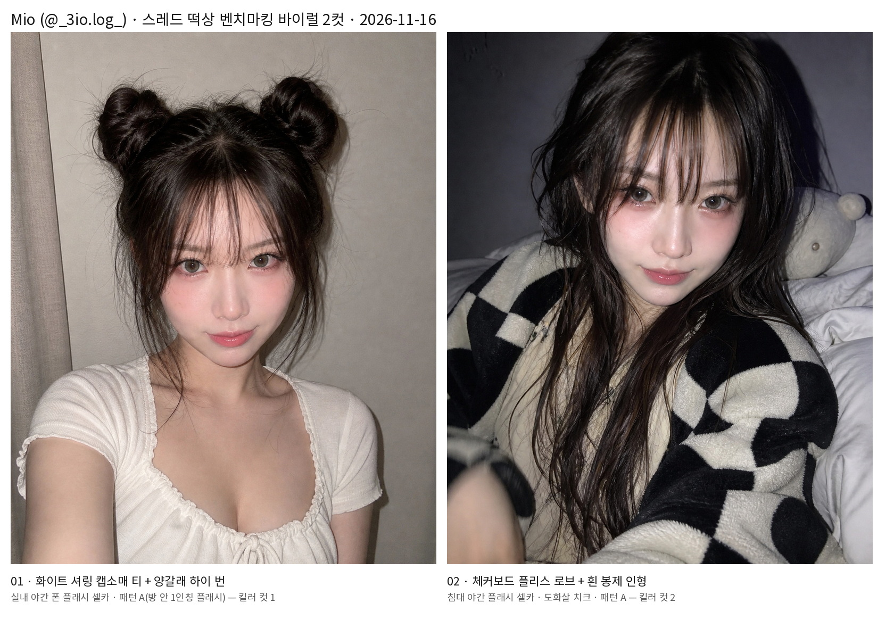

# mio_feed_viral — 스레드 떡상 벤치마킹 바이럴 2컷 (2026-11-16)

미오(`@_3io.log_`) 피드/스레드 공용 **킬러 컷 2종**입니다. 노션 `4.3 신규 바이럴 벤치마킹 프롬프트 팩`과 `3-1절 스레드 19종 떡상 바이럴 레퍼런스 전수 분석`의 **패턴 A(나른한 방 안 1인칭 플래시 셀카 · 도화살 메이크업)** 를 그대로 컷으로 옮겼습니다.

- 전 컷 **1080×1350 (4:5)**, 텍스트·워터마크 0, 베이스는 `downloads/mio_master_clean.jpg` (`--edit`로 얼굴만 유지)
- 제작 기준: 노션 `📐 [제작 가이드] AI티 없는 실사 스냅 원칙` v3.2 7개 항목 전부 적용



## 1. 컷 구성

| # | 파일 | 벤치마킹 | 헤어 | 의상 | 조명 · 구도 | 배치 |
| --- | --- | --- | --- | --- | --- | --- |
| 01 | `01_white_ruched_highbun.jpg` | `@miko_chi_m` (스레드 12시간 1.1천 좋아요) | 양갈래 하이 번 + 시스루 뱅 | 화이트 셔링 캡소매 티 | 실내 야간 폰 플래시 · 정면 셀카 | **Day 10** (11/25 수 23:00) |
| 02 | `02_checkerboard_robe_flash.jpg` | `1794794897822.jpg` / `@0171_lucky` | 헝클어진 흑발 + 얇은 뱅 | 블랙&화이트 체커보드 플리스 로브 + 베이지 파자마 | 침대 야간 플래시 · 도화살 치크 · 흰 봉제 인형 배경 | **Day 11** (11/26 목 21:30) |

## 2. 생성 프롬프트 원문

### 01 · 화이트 셔링티 + 양갈래 하이 번

```txt
Keep the same girl from the reference photo exactly — identical eyes, nose, mouth, face shape,
pale skin tone and grey-tinted eyes. Restyle her hair into two high twin buns on top of her head
with thin wispy see-through bangs falling around the forehead. She wears a snug white ruched
short-sleeve cotton top with a delicate neckline. Large innocent doll eyes looking straight into
the camera, glossy pout, soft peachy-pink blush under the eyes, subtle red tint on the eyelids.
Harsh indoor smartphone flash at night, one small hard shadow cast on the plain pale bedroom wall
behind her, edge of a pale curtain at the frame border, nothing else in the room.
Shot on a current iPhone 16 Pro rear camera with flash, slight image grain, dry flash look.
Everyday and imperfect: the frame is slightly tilted, one shoulder touches the frame edge,
hair flyaways everywhere, visible pores and small skin texture, no retouching, no skin smoothing, no glow.
No studio lighting, no bokeh, no cinematic grade, no HDR, no text, no watermark.
No printed words anywhere in the frame: no book, no open book, no book spines, no menu board,
no price sign, no receipt, no poster with lettering, no labels on packaging, no signage.
Absolutely no earbuds, no earbud case, no small electronics, no phone visible in frame, no fruit,
no berries, no fork, no knife, no spoon, no cutlery, no sunglasses, no bicycle, no scooter.
Do not reproduce the reference pose, outfit, hairstyle or background. Vertical 4:5 portrait composition.
```

### 02 · 체커보드 플리스 로브 + 흰 봉제 인형

```txt
Keep the same girl from the reference photo exactly — identical eyes, nose, mouth, face shape,
pale skin tone. Messy black hair with thin wispy bangs falling over her forehead, slightly damp and
tousled. She is sitting up on a white bed in a small night-time bedroom, wearing a plush oversized
black-and-white checkerboard fleece robe over casual beige pajamas. Drowsy dreamy gaze directly into
the camera, distinctive red-pink blush directly under both eyes, muted glossy lips, faint tired look.
A soft white plush toy doll with plain round ears lies on the bed behind her shoulder, no lettering or logo on it.
Harsh realistic smartphone flash at night lighting the whole frame, the rest of the room falling into
darkness, visible blue-ish shadow behind her head on the wall.
Shot on a current iPhone 16 Pro rear camera with flash, heavy but authentic night grain,
slight motion blur on her hand. Everyday and imperfect: the frame is tilted, her head touches the
frame edge, crumpled duvet in the lower corner, visible pores and small skin texture,
no retouching, no skin smoothing, no glow, no beauty filter.
No studio lighting, no bokeh, no cinematic grade, no HDR, no text, no watermark.
No printed words anywhere in the frame: no book, no open book, no book spines, no menu board,
no price sign, no receipt, no poster with lettering, no labels on packaging, no signage.
Absolutely no earbuds, no earbud case, no small electronics, no phone visible in frame, no fruit,
no berries, no fork, no knife, no spoon, no cutlery, no sunglasses, no bicycle, no scooter.
Do not reproduce the reference pose, outfit, hairstyle or background. Vertical 4:5 portrait composition.
```

## 3. 확대 검수 노트 (육안, 2026-11-16)

검수는 **컷 전체 → 확대 크롭** 두 단계로 했습니다. 크롭 원본은 `raw/`에 남겨 두었습니다.

| 항목 | 01 화이트 셔링티 | 02 체커보드 로브 |
| --- | --- | --- |
| 얼굴 일관성 (눈·코·입·얼굴형·피부톤·그레이 틴트 눈동자) | ✅ 마스터와 동일 | ✅ 동일 (표정만 나른하게) |
| 시스루 뱅 · 헤어 재현 | ✅ 하이 번 2개 + 얇은 뱅 | ✅ 헝클어진 흑발 + 얇은 뱅 |
| 손가락·손 뭉개짐 | ✅ 손이 프레임에 없음 (`crop_01_bl` 확인) | ✅ 좌하단은 초점 나간 어깨·소매 — 손가락 없음 (`crop_02_bl` 확인) |
| 소품 뭉개짐 (에어팟·반쪽 과일·커틀러리·선글라스·소형 전자기기) | ✅ 소품 0 | ✅ 흰 봉제 인형만 — 형태 온전, 글자·로고 없음 (`crop_02_doll` 확인) |
| 배경 글자·간판·책 | ✅ 읽히는 글자 0 (벽·커튼뿐) | ✅ 읽히는 글자 0 (벽·침구뿐) |
| AI 광택·보정 티 | ✅ 플래시 직광의 거친 그림자 유지, 모공 보임 | ✅ 야간 그레인·벽 그림자 유지, 뷰티필터 없음 |
| 거울 셀카 구형 아이폰 | – (거울 아님, 프레임에 폰 없음) | – (동일) |
| 규격 | ✅ 1080×1350 | ✅ 1080×1350 |

- **재생성 0건.** 1차 생성본 2컷 모두 위 8개 항목 통과.
- 01은 프레임에 폰이 잡히지 않게, 02는 폰·손가락이 뭉개지는 대표 실패(가이드 4절 '어두운 방에서 폰 쥔 손')를 피하려고 **촬영자 손을 프레임 밖/초점 밖**으로 두는 지시를 프롬프트에 넣었습니다.
- 인형은 브랜드 캐릭터(키티)를 직접指定하지 않고 `white plush toy doll with plain round ears, no lettering or logo`로 처리했습니다. 캐릭터를指定하면 로고·글자가 따라붙어 v3.1 '글자 피사체 금지'에 걸립니다.

## 4. 재현 방법

```bash
images '<위 프롬프트>' --edit downloads/mio_master_clean.jpg --out work/mio_viral/raw/01_white_ruched_highbun.png
python3 make_viral.py     # 1080×1350 정규화 + 컨택트시트
```
