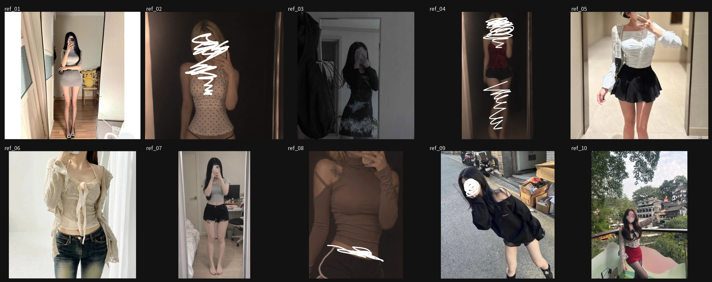

# 🥕 당근 인기 레퍼런스 10장 (2026-11-17, 기운님 직접 수집)

기운님이 당근(중고거래 앱)에서 직접 수집해 보낸 인기 게시물 사진 10장을 **화면 UI 없이 사진 본체만** 잘라낸 아카이브입니다. 노션 「인스타그램 일본인 감성 AI 모델 기획 및 실행 가이드」(`419ef9e2-9771-819d-8bfa-ee3323cd99ae`)의 「🥕 [당근 인기 레퍼런스 10종]」 섹션에 임베드되어 있습니다.

원본은 878×2048 세로 화면 캡처(당근 이미지 뷰어)이며, 상하 검정 레터박스·상태바·`×` 닫기 버튼·하단 페이지 점(`• •`)과 사진 위에 겹친 `2/3` 장수 배지를 잘라낸 뒤 사진 영역만 남겼습니다.

## 컷별 정리

| # | 파일 | 크기 | 구도 | 의상 | 배경 | 미오 적용 포인트 |
| --- | --- | --- | --- | --- | --- | --- |
| 01 | `ref_01.jpg` | 878×826 | 방문 앞 전신 거울셀카, 정면·정수리 여백 넉넉 | 회색 골지 슬리브리스 미니 원피스, 블랙 크로스백, 베이지 뮬 | 밝은 흰 벽 + 나무 바닥, 화장대·서랍장 | **거울셀카 기본형.** 얼굴 가림 없이 표정이 살아 있고, 실내 자연광 톤이 미오의 '청순 무드'와 가장 가깝다. 3:4 세로 크롭의 기준 컷으로 쓰기 좋다. |
| 02 | `ref_02.jpg` | 878×812 | 어두운 방 상반신, 손으로 얼굴·휴대폰 가림 | 화이트 도트 홀터 탑 | 어두운 방, 낮은 조도 | **저조도 플래시 톤 참고용.** 도트 패턴·홀터 넥 라인의 질감 묘사. 얼굴이 가려져 있어 표정 참고는 불가. |
| 03 | `ref_03.jpg` | 878×961 | 문가 전신 거울셀카, 어두운 실루엣 | 블랙 셔링 원피스 | 어두운 방 + 밝은 문틀 대비 | **역광 실루엣 구도.** 몸 라인과 원단 주름만 보이게 하는 어두운 노출 — 미오 피드의 '무드 컷' 변주에 사용. |
| 04 | `ref_04.jpg` | 878×1560 | 어두운 방 전신, 정면 | 버건디 코르셋 홀터 + 블랙 트레이닝 숏 | 어두운 방, 스트립 조명 | **버건디 컬러 포인트.** 어두운 톤에서 붉은 상의만 살아나는 색 대비. 과감한 컷이 필요할 때 참고. |
| 05 | `ref_05.jpg` | 878×815 | 아파트 복도 전신 거울셀카, 정면 | 화이트 셔링 오프숄더 블라우스 + 블랙 플리츠 미니 + 블랙 크로스백 | 밝은 아파트 복도, 베이지 타일 | **오프숄더 + 플리츠 조합의 교과서.** 미오 마스터 컷(오프숄더 크림 니트)과 톤이 같아 바로 프롬프트화하기 좋다. |
| 06 | `ref_06.jpg` | 878×883 | 창가 상반신, 커튼 배경 | 크림 레이스 홀터 탑 + 시어 가디건 + 데님 | 밝은 방, 흰 커튼 역광 | **레이스·시어 소재 표현.** 역광으로 비치는 얇은 원단 묘사 참고. |
| 07 | `ref_07.jpg` | 878×1562 | 원룸 전신 거울셀카, 맨발 | 회색 크롭 티 + 블랙 데님 숏팬츠 | **한국 원룸** — 침대·책상·모니터·행거 | **한국 원룸 톤의 기준 컷.** '일본인 모델이 서울 원룸에 산다'는 미오 설정을 가장 사실적으로 보여주는 배경. |
| 08 | `ref_08.jpg` | 878×1193 | 어두운 방 상반신, 정면 | 브라운 오프숄더 터틀 롱슬리브 + 블랙 트레이닝 숏 | 어두운 방 | **브라운 니트 톤.** 어두운 조명에서 갈색 니트가 어떻게 떨어지는지 참고. |
| 09 | `ref_09.jpg` | 878×987 | 골목에서 몸을 숙인 역동적 포즈, 로우앵글 | 블랙 오프숄더 맨투맨 + 블랙 숏팬츠 + 니하이 부츠 | **한국 주택가 골목** — 주차된 오토바이, 계단, 종이박스 | **한국 골목 스냅의 기준 컷.** 스튜디오가 아닌 '생활 배경'에서 미오를 찍을 때의 구도·포즈 참고. |
| 10 | `ref_10.jpg` | 878×1170 | 야외 난간 앞 전신, 손 흔드는 포즈 | 레오파드 시어 블라우스 + 레드 스커트 + 블랙 타이츠 | 물가 마을 전망대(중국 항저우풍) | **여행지 스냅 구도.** 배경 원경 + 인물 전신의 비율 참고. 레드 스커트의 색 대비. |

## 미오 제작에 바로 쓰는 3가지

1. **거울셀카 구도 (ref_01 · ref_05 · ref_07)** — 세로 3:4, 정면 전신, 정수리 위 여백 10~15%, 카메라를 가슴 높이에 두고 살짝 내려다보는 각도. 미오 피드의 기본 컷으로 가장 안정적이다.
2. **한국 골목 / 원룸 톤 (ref_07 · ref_09)** — 배경에 한국 특유의 요소(원룸 가구, 오토바이, 계단, 종이박스)를 넣으면 '일본인 감성'이 '서울 거주'로 자연스럽게 이어진다. 배경은 흐리게, 인물에만 초점.
3. **마스터 얼굴 합성 가이드** — 위 10장은 **얼굴을 그대로 쓰는 자료가 아니다.** 구도·의상·배경·조명만 추출하고, 얼굴은 레포 루트의 미오 마스터 컷(`338.jpg`, 눈매 50% + 사슴상 50%)을 기준으로 합성한다. 인물의 실제 얼굴·문신·체형을 복제하지 않는다.

## 수집·전처리 메모 (2026-11-17)
- 원본: 기운님이 당근에서 직접 수집해 채팅으로 보낸 화면 캡처 10장(`attachments/2026-11-17/`, 878×2048).
- 전처리: Python(PIL/OpenCV)로 ① 상하 검정 레터박스, ② 상태바·`×` 버튼, ③ 하단 페이지 점, ④ 사진 위 `2/3` 장수 배지(해당 컷은 배지 아래로 크롭)를 제거. EXIF·워터마크 없음.
- 일부 원본에는 게시자가 얼굴·다리에 그려 넣은 **흰색 낙서**가 그대로 남아 있습니다(ref_02·ref_03·ref_04·ref_08·ref_09). 사진 자체에 포함된 표시라 지우지 않았습니다.
- 이 사진은 **벤치마킹 참고용**입니다. 미오(@_3io.log_) 피드에 그대로 올리지 말고 구도·조명·스타일만 추출해 쓰십시오.
