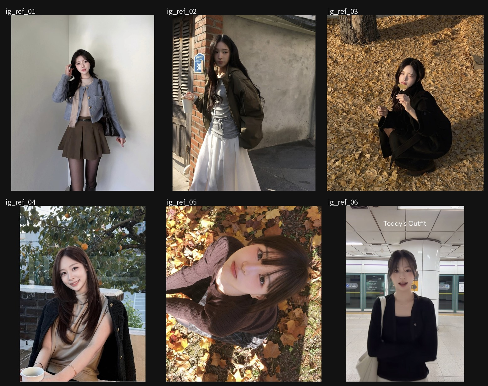

# 📸 인스타 인기 레퍼런스 6장 (2026-11-17, 가을·서울 야외 톤)

기운님이 인스타그램에서 골라 보낸 인기 게시물 사진 6장을 **앱 UI 없이 사진 본체만** 잘라낸 아카이브입니다. 노션 「인스타그램 일본인 감성 AI 모델 기획 및 실행 가이드」(`419ef9e2-9771-819d-8bfa-ee3323cd99ae`)의 「📸 [인스타 인기 레퍼런스 6종]」 섹션에 임베드되어 있습니다.

원본은 878×2048 세로 화면 캡처(인스타그램 피드/릴스 뷰어)이며, 상단 프로필 바·`×`/`⋯`, `3/6`·`1/20` 같은 장수 배지, 하단 좋아요·댓글 바, 음소거/인물태그 아이콘을 잘라내거나 주변 배경으로 복원해 사진만 남겼습니다.

## 컷별 정리

| # | 파일 | 계정 | 크기 | 구도 | 의상 | 배경 | 미오 적용 포인트 |
| --- | --- | --- | --- | --- | --- | --- | --- |
| 01 | `ig_ref_01.jpg` | @s2__eunhee | 878×1079 | 흰 벽 앞 전신, 손으로 머리 넘기는 포즈 | 블루 트위드 자켓 + 아이보리 톱 + 브라운 플리츠 미니 + 블랙 타이츠 + 블랙 부츠, 블랙 숄더백 | 화이트 스튜디오 벽 | **가을 트위드 코디의 기준 컷.** 무채색 벽 + 파랑·브라운 색 조합. 미오의 '단정한 외출복' 버전. |
| 02 | `ig_ref_02.jpg` | @daybin_official | 878×1080 | 골목 벽돌 건물 앞 전신, 자연스럽게 걷다 멈춘 자세 | 카키 야상 + 그레이 스트링 탑 + 화이트 롱 플리어 스커트 | 동교로51안길, 벽돌·회벽·파란 주소판('30') | **서울 골목 야외 스냅.** 벽·간판·보도블록이 주는 '동네 톤'이 미오의 서울 거주 설정에 그대로 맞는다. |
| 03 | `ig_ref_03.jpg` | @zeee.u | 878×985 | 쪼그려 앉아 은행잎을 입에 대는 포즈, 측면 3/4 | 검정 롱코트 | **은행잎이 깔린 가을 바닥** | **가을 시즌 컷.** 바닥을 채우는 낙엽 질감과 낮은 앵글. 좋아요 7.4k로 반응이 검증된 구도. |
| 04 | `ig_ref_04.jpg` | @haxrin.days | 783×1096 | 테라스 의자에 앉아 정면 미소, 머그컵 든 손 | 베이지 슬리브리스 터틀 + 블랙 니트 가디건 | 야외 테라스, 감나무·파라솔·유리 난간 | **카페/테라스 인물 컷.** 자연광 얼굴 클로즈업과 소품(머그컵) 활용. 미오의 '일상 데일리' 톤. |
| 05 | `ig_ref_05.jpg` | @ezjzzz | 878×995 | **하이앵글**(위에서 내려다보는) 얼굴 클로즈업 | 브라운 케이블 니트 | 단풍잎이 깔린 땅 | **하이앵글 셀카 구도.** 좋아요 2.4만으로 이번 묶음 최고 반응. 미오 피드의 '얼굴 강조' 컷으로 바로 응용. |
| 06 | `ig_ref_06.jpg` | @8yes8 | 878×1305 | 지하철 승강장 정면, 가방 멘 채 서 있는 자세 | 블랙 원피스 + 블랙 가디건, 화이트 숄더백 | 서울 지하철 승강장(스크린도어·기둥) | **도시 일상 톤.** 형광등 아래에서의 피부·검정 의상 표현. 'Today's Outfit' 텍스트 오버레이는 원본 게시자가 영상에 넣은 것으로 지우지 않았다. 좋아요 1.9만. |

## 미오 제작에 바로 쓰는 포인트

- **시즌 톤**: 이 6장은 전부 10~11월 가을이다(낙엽·은행잎·단풍·코트·니트). 미오 피드를 가을 시즌으로 맞출 때 색 팔레트(브라운·카키·크림·블랙)와 광원(낮은 태양, 긴 그림자)을 여기서 가져간다.
- **구도 3종**: ① 벽 앞 전신(01) ② 골목/야외 전신(02) ③ 하이앵글 얼굴 클로즈업(05). 이 셋만 섞어도 피드 리듬이 생긴다.
- **얼굴은 합성**: 위 사진의 얼굴을 그대로 쓰지 않는다. 레포 루트 `338.jpg`의 미오 마스터 얼굴을 기준으로 구도·의상·배경·조명만 이식한다.

## 수집·전처리 메모 (2026-11-17)
- 원본: 기운님이 인스타그램에서 골라 채팅으로 보낸 화면 캡처 6장(`attachments/2026-11-17/`, 878×2048).
- 전처리: 상단 프로필/뒤로가기 바, `⋯`, `×`, 우상단 장수 배지(`3/6`·`1/20`·`1/10`·`1/12`), 하단 좋아요·댓글·공유 바, 사진 위 음소거 아이콘·인물태그 아이콘 제거. 아이콘은 ① 배지·아이콘 아래/옆으로 크롭하거나 ② 주변 배경으로 복원(OpenCV inpaint)했다.
- `ig_ref_04.jpg`는 좌하단 인물태그 아이콘을 피하려고 **왼쪽을 95px 잘라** 783px 폭이 되었다.
- `ig_ref_03.jpg`·`ig_ref_05.jpg`는 하단 아이콘을 피해 아래쪽을 조금 잘랐다.
- 이 사진은 **벤치마킹 참고용**입니다. 미오 피드에 그대로 올리지 말고 구도·조명·스타일만 추출해 쓰십시오.
