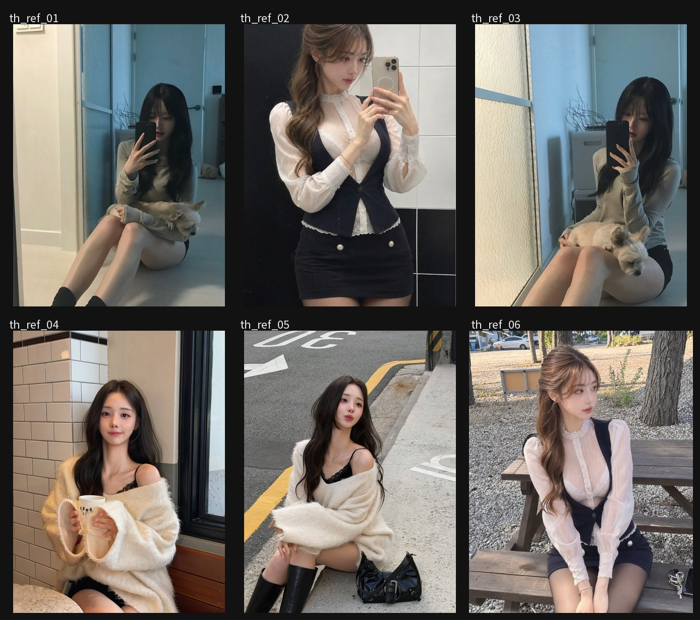

# 🧵 스레드 추가 레퍼런스 6장 (2026-11-17)

기운님이 스레드에서 골라 보낸 인기 게시물 사진 6장을 **앱 UI 없이 사진 본체만** 잘라낸 아카이브입니다. 노션 「인스타그램 일본인 감성 AI 모델 기획 및 실행 가이드」(`419ef9e2-9771-819d-8bfa-ee3323cd99ae`)의 「🧵 [스레드 추가 레퍼런스 6종]」 섹션에 임베드되어 있습니다.

원본은 878×2048 세로 화면 캡처(스레드 이미지 뷰어)이며, 상단 `×`·`⋯` 버튼과 하단 좋아요·댓글·리포스트·공유 바를 잘라내고, 한 장에 겹쳐 있던 스크린샷 미리보기 썸네일도 제외했습니다.

## 컷별 정리

| # | 파일 | 크기 | 구도 | 의상 | 배경 | 미오 적용 포인트 |
| --- | --- | --- | --- | --- | --- | --- |
| 01 | `th_ref_01.jpg` | 878×1169 | 실내 복도 거울셀카, 바닥에 앉아 강아지를 안은 전신 | 그레이 루즈 롱슬리브 + 블랙 숏 | 흰 벽·창문·유리문이 있는 복도 | **반려동물 동반 거울셀카.** 좋아요 363. 미오 피드에 '강아지와 사는 일상' 컷을 넣을 때의 구도 기준. |
| 02 | `th_ref_02.jpg` | 878×1169 | 타일 벽 거울셀카, 휴대폰 든 상반신 | 화이트 시스루 레이스 블라우스 + 네이비 브이 베스트 + 블랙 미니스커트(진주 버튼) | 흰 타일 + 검정 벽 대비 | **시스루 레이스 + 베스트 레이어드.** 좋아요 994. 미오의 '청순 + 단정' 라인에서 가장 재현성이 높은 조합. |
| 03 | `th_ref_03.jpg` | 878×1169 | 문가에 앉아 강아지를 안은 모습, 정면 클로즈업 | 그레이 루즈 롱슬리브 | 파란 문·벽, 실내 | **01과 같은 날 다른 컷.** 같은 의상·장소에서 앵글만 바꾼 2컷 세트 구성 참고. |
| 04 | `th_ref_04.jpg` | 878×1169 | 카페 테이블에 앉아 정면 미소, 머그컵 든 두 손 | 아이보리 앙고라 니트(오프숄더) + 블랙 레이스 캐미솔 | 타일 벽 카페, 창가 | **앙고라 니트 + 레이스 캐미솔.** 좋아요 5천. 부드러운 원단 질감과 실내 조명 표현. |
| 05 | `th_ref_05.jpg` | 878×1169 | 도로변에 앉아 측면 응시, 전신 | 아이보리 앙고라 니트 오프숄더 + 블랙 레이스 + 블랙 롱부츠 + 블랙 백 | 아스팔트 도로, 노란 차선, '30' 노면 표지 | **야외 로우앵글 전신.** 좋아요 5천. 04와 같은 의상으로 실내/야외 2컷을 만든 세트 — 미오도 한 의상으로 2~3컷을 뽑는 방식에 그대로 적용. |
| 06 | `th_ref_06.jpg` | 878×1105 | 야외 피크닉 테이블에 앉은 3/4 측면 | 화이트 시스루 블라우스 + 네이비 베스트 + 블랙 숏스커트, 블랙 타이츠 | 공원 피크닉 테이블, 나무·자갈·주차장 | **야외 자연광 3/4 컷.** 시선을 옆으로 둔 '무심한' 표정 — 미오 피드의 과하지 않은 톤 reference. |

## 미오 제작에 바로 쓰는 포인트

- **한 의상으로 2컷**: 04·05(같은 앙고라 니트의 실내/야외), 01·03(같은 룩의 전신/클로즈업)처럼 한 룩을 장소와 앵글만 바꿔 2장씩 뽑으면 피드가 자연스럽다.
- **레이어드 공식**: 시스루 블라우스 + 브이 베스트(02·06), 앙고라 니트 + 레이스 캐미솔(04·05). 미오의 오프숄더 크림 니트 마스터 컷과 같은 계열이라 프롬프트 재사용이 쉽다.
- **얼굴은 합성**: 이 6장의 얼굴을 그대로 쓰지 않는다. 레포 루트 `338.jpg`의 미오 마스터 얼굴을 기준으로 구도·의상·배경·조명만 이식한다.

## 수집·전처리 메모 (2026-11-17)
- 원본: 기운님이 스레드에서 골라 채팅으로 보낸 화면 캡처 6장(`attachments/2026-11-17/`, 878×2048).
- 전처리: 상단 `×`·`⋯`, 하단 반응 바(좋아요·댓글·리포스트·공유) 제거. `th_ref_06.jpg`는 좌하단에 겹쳐 있던 스크린샷 미리보기 썸네일을 피하려고 아래쪽을 잘라냈다.
- 계정 핸들은 원본 캡처에 표시되지 않아 기록하지 않았다(기운님 전달 묶음 기준).
- 이 사진은 **벤치마킹 참고용**입니다. 미오 피드에 그대로 올리지 말고 구도·조명·스타일만 추출해 쓰십시오.
